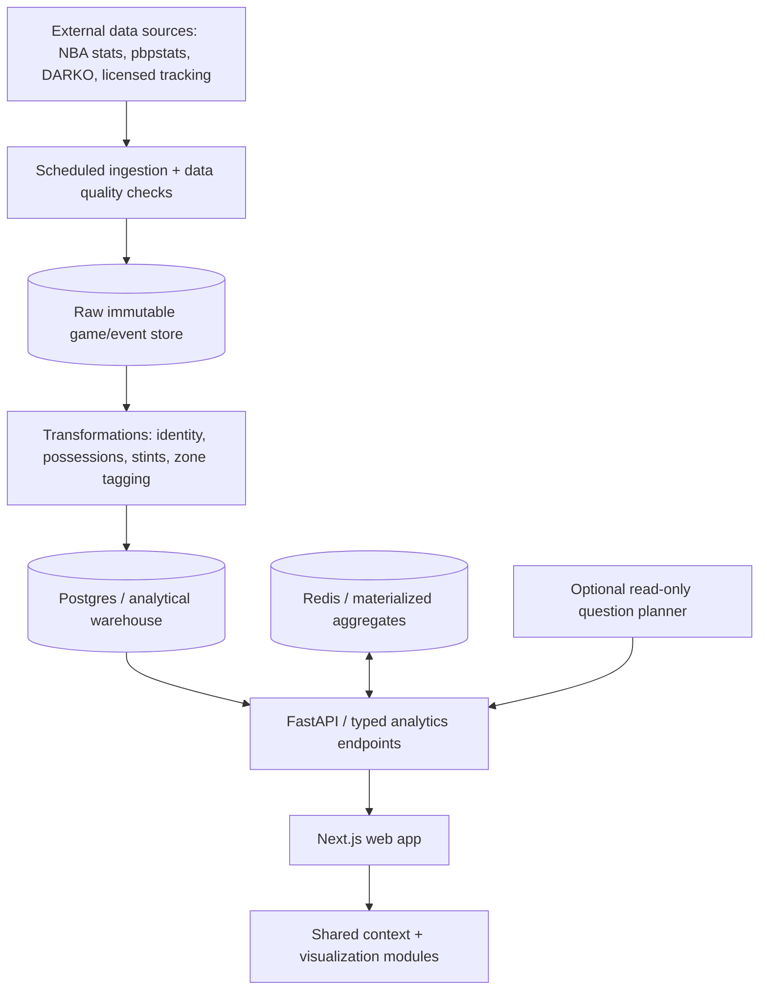

# ballknowledge — System Architecture & Product Specification

**Status:** Proposed architecture (not yet implemented)  
**Version:** 0.1.0  
**Created:** October 25, 2026  
**Application:** `ballknowledge`  
**Category:** NBA data exploration and player-intelligence web application

> **Purpose:** Single source of truth for product modules, routes, component architecture, analytics definitions, data pipelines, API contracts, database entities, and implementation sequence for **ballknowledge**. This is a build specification, not a claim that any of these components already exist.
>
> **Reference and originality:** Product inspiration comes from public-facing Hoopology analytics experiences (see appendix). Implement independent UI, code, brand, calculations, and licensed/authorized data access. References marked **Reference behavior (research)** describe inspirations, not requirements or verified internals.

## 0. Product vision and engineering decisions

**Mission:** Give basketball analysts, fans, researchers, and decision-makers a unified workspace to ask who is performing well, why they are performing well, how they fit with other players, and whether an apparent impact holds up under contextual filters.

**Core interaction:** **Select season / date range / population → inspect leaders → drill into players or teams → compare metrics and lineups → share reproducible analysis**.

### 0.1 Navigation map for ballknowledge

```text
ballknowledge
├── Overview / Home                    /
├── Regular Season                     /season/[season]
│   ├── Calendar & Games               /season/[season]?tab=games
│   ├── Leaders                        /season/[season]?tab=leaders
│   ├── Stat Table                     /season/[season]?tab=stats
│   ├── Player Scatter                 /season/[season]?tab=scatter
│   └── Scoring Profiles               /season/[season]?tab=scoring
├── Player Intelligence
│   ├── Player Explorer                /players
│   ├── Player Dashboard               /players/[playerId]
│   ├── Player Comparison              /compare/players
│   ├── Player Scatter                 /explore/players
│   ├── All-Time / Master Scatter      /explore/history
│   ├── Scoring Profile                /scoring/players/[playerId]
│   └── Player Rankings                /rankings/players
├── Team Intelligence
│   ├── Teams                          /teams
│   ├── Team Dashboard                 /teams/[teamId]
│   ├── Team Scatter                   /explore/teams
│   ├── Team Comparison                /compare/teams
│   └── Team Scoring Profile           /scoring/teams/[teamId]
├── Impact & Fit
│   ├── On/Off Analysis                /impact/on-off
│   ├── Teammate Pair Splits           /impact/teammates
│   ├── Lineup Explorer                /lineups
│   ├── Lineup Matrix                  /lineups/matrix
│   └── Matchup Explorer               /matchups
├── Playoffs                           /playoffs/[season]
├── Statistical Database               /stats
├── Saved Views / Exports              /workspace
└── Optional Later
    ├── Ask ballknowledge              /ask
    ├── Film Room                      /film
    └── Fan / Games features           /games
```

### 0.2 Shared analytics context

All analytics screens use a typed `AnalysisScope` persisted in shareable URL parameters:

```ts
type AnalysisScope = {
  league: 'NBA' | 'WNBA';             // launch with NBA only
  season: string;                    // e.g. '2026-2027'
  seasonType: 'regular' | 'playoffs';
  dateFrom?: string;                  // ISO date inclusive
  dateTo?: string;                    // ISO date inclusive
  teamIds?: number[];
  playerIds?: number[];
  minMinutes?: number;
  minPossessions?: number;
  perMode: 'totals' | 'per_game' | 'per_36' | 'per_75' | 'per_100';
};
```

User-selectable `scope` must produce consistent populations across charts, tables, and exports. Metrics unavailable for a selected season are marked unavailable rather than replaced with zeros.

### 0.3 Technology selections (initial recommendation)

| Layer | Technology | Rationale |
|---|---|---|
| Web | Next.js + React + TypeScript | Routing, sharing, SSR for public pages |
| UI | Tailwind CSS + accessible headless controls | Consistent design and efficient filter composition |
| Query and tables | TanStack Query + TanStack Table | Cached requests, large customizable stat tables |
| Charts | Apache ECharts + D3 for specialty court graphics | Interactivity and basketball-specific custom views |
| API | Python FastAPI + Pydantic | Typed analytics contracts, Python analysis ecosystem |
| Storage | PostgreSQL + Parquet/object storage | Relational dimensions, analytical facts, source snapshots |
| Background jobs | Prefect (or Dagster; choose one) | Auditable ETL, corrections and historical backfills |
| Cache | Redis | Reused parameterized analytics queries |
| Auth (later) | Hosted OAuth provider | Saved presets without password handling |
| Observability | Structured logs + tracing + freshness dashboards | Explain failed and stale analyses |

**Scope rule:** Redis, worker queues, advanced data warehouse, auth and AI assistance are not hard prerequisites for the first release; add only when scale or features justify them.

### 0.4 MVP definition

**V1 should ship:** a regular-season game calendar, date-window selector, player/team stat database, player page with logs and trends, leaderboard, and configurable scatter plot, all using consistent scope + official IDs + exportable CSV.

**V1 should not claim:** possession-accurate on/off, player tracking, matchup stats, and historical shot-type coverage until their source, semantics, permissions, and QA checks have been validated.

---

## 2. Full feature inventory by module

### 2.1 Regular Season hub — `regular-season?season=2026-2027`

**Reference behavior (research)**
- Season switcher and calendar showing games per day.
- All-team view or filter calendar to an individual team's schedule.
- Select day, month, or arbitrary start/end dates.
- Game listing with matchup, home/away team and tip-off; completed games can expose box scores, game statistics, four factors, scoring profiles, and (per homepage) highlights.
- Cross-view data scoping for **Leaders**, **Stat Table**, **Scatter Plot**, **Scoring Profile** over the selected date range.
- Date-range tracking, hustle, defense, shot-zone, shot-type and clutch statistics (examples: drives, deflections, contested shots, rim protection).
- Export tables/charts with date filters identified.

**Recommended reproduction behaviors**
- One shared `AnalysisContext` controls season, season type, team, window, minimum sample, normalization, and selected stat categories.
- Date range as canonical URL state, e.g. `?season=2026-2027&from=2026-10-20&to=2026-10-25&team=ALL&tab=leaders`.
- One-click switch from a day's game list to filtered player leaderboards.
- Distinguish scheduled/not played, live/incomplete, and finalized games; avoid treating unplayed games as zeroes.

### 2.2 Leaders / Stats database

**Reference behavior (research)**
- 250+ metrics; season-level database described as dating to 1996–97 (other all-time tools extend further, depending on data availability).
- Leaderboard table with sorting by any selected statistic.
- Filters: team, position, minutes, games, age, draft class, arbitrary stat threshold.
- Normalization: per game, per 75 possessions, totals, relative to league.
- Category presets: scoring, shooting, playmaking, defense, rebounding, shot zones, tracking, hustle, clutch, play types, on/off.
- Stat percentiles computed with a defined eligible population; saved custom column sets.
- All-Time view either player-season rows or multi-year aggregate; export tables and player cards to image (homepage also mentions CSV).

**Proposed feature specification**
- Searchable metric catalog with definition, units, denominator, directionality (`higher_is_better`), season coverage and source.
- Eligibility and minimum sample configuration visible with percentiles.
- Show missing/unavailable rather than `0` when the upstream stat does not exist for a season.
- Export metadata: season, date filter, league, sample threshold, normalization, query timestamp.

### 2.3 Player Dashboard

**Reference behavior (research)**
- Player identification and chosen season.
- Customizable per-game log.
- Splits: last 5/10/20 games, month, home/away, wins/losses, opponent defensive strength.
- Regular season versus playoff splits.
- Statistical trend charts and rolling averages.
- Integrated on/off impact and defensive matchup information; career/player cards and scoring profile access described across the site.

**Proposed design regions**: player identity header; headline KPI cards; split explorer; game log; rolling stat chart; efficiency and shot mix; on/off; matchup panel; career timeline.

### 2.4 Team Dashboard

**Reference behavior (research)**
- Team-level ORtg, DRtg and NetRtg with league rankings.
- Scoring mix by play type and shot zone, usage/efficiency league ranks.
- Franchise history table and current-season roster with individual player statistics.

**Proposed**: team trendline, roster distribution, lineup drilldown, strength-of-schedule context, four-factor comparison.

### 2.5 Player Scatter Plot

**Reference behavior (research)**
- Select independent X-axis and Y-axis from 250+ metrics.
- Per-game, per-75, total views.
- Filters by season, team, position, minutes and specific metric ranges.
- Highlight individual players and whole teams, invert metric direction if lower is better.
- Export plot as shareable image; compare across eras using related tools.

**Proposed**: quadrant lines (league medians or custom), player labels, hover cards, brush selection, color by team/position, optional point size by minutes and URL-persisted controls.

### 2.6 Team Scatter / Master Scatter / Matchup Scatter

**Observed/Documented from homepage**
- **Team Scatter:** plot 30 NBA teams against 100+ metrics, including ORtg, DRtg and pace.
- **Master Scatter:** pool historical player seasons as chart points, pick years/ranges/decades and spotlight players; coverage described to 1983–84.
- **Matchup Scatter:** defensive player-vs-player matchup stats (FG%, points allowed, defensive possessions), described since 2013–14.

**Limit:** Specific advanced filters and route-level interactions were not available for direct verification. Implement common scatter engine with entity-specific row types and matchup-specific thresholds.

### 2.7 Compare players / teams

**Reference behavior (research)**
- Side-by-side comparison of up to five players or teams.
- Pick different seasons, including regular season and playoffs; historical coverage indicated to 1996–97.
- Preset stat groups and data normalization (Per Game / Per 75 / Totals).
- League/selected cohort/same-position percentile and ranking comparisons; highlight leading values.
- Pool multiple player-seasons into one cumulative column with counting stats summed and percentages recalculated from their underlying made/attempted totals (not average percentages).
- Shareable URL and image export.

### 2.8 Scoring Profile

**Reference behavior (research)**
- Play-type distribution and scoring: isolation, pick-and-roll, spot-up, post-up, handoff, cutting, transition, etc.
- Pie/mix charts, frequency, efficiency, league percentiles.
- Shot-zone breakdown, FG% percentile rankings.
- Filters for position comparison pool and team; deep link from specific zone/play type into scatter analysis.

**Proposed**: separate **volume**, **frequency**, **points per possession**, **eFG%**, and **percentile** to avoid conflating usage with ability. Preserve per-stat source coverage caveats.

### 2.9 On/Off Impact

**Reference behavior (research)**
- Chosen player team performance on court vs off court: offensive, defensive, net ratings, net swing.
- Teammate with/without-player splits and teammate shooting effects.
- Assist-network relationships and comparisons of up to three players.
- Regular/playoff toggles; per game, per 36, and totals; minute filter.
- Views labeled **Stats Table** and **Player Impact** on the current interface.

**Recommended domain model**
- Derive on/off from stint, score, possession, and player presence data; clearly show on/off minutes and possessions.
- Support full team games, strict shared-game off samples, and date-restricted comparisons as separate methodological choices.
- Label raw descriptive differences *association*, not automatically causal player impact.

### 2.10 Lineups / Lineup Matrix

**Reference behavior (research)**
- 2-, 3-, 4-, and 5-player combinations; five-player lineups explicitly ranked.
- Leaderboard and Team Breakdown; a Lineup Matrix button is visible.
- Team, season, regular/playoffs, minutes, start date and end date filters.
- ORtg, DRtg, NetRtg, minutes, possessions; per-game lineup log.
- Assist-network behind scoring; lineup card exports.
- Builder and Full View controls present.

**Limit:** Matrix semantics and exact builder algorithms could not be exercised. Do not claim verified cell definitions; proposed matrix: players-by-players pair net ratings with tooltips for minutes, possessions, ORtg/DRtg.

### 2.11 Playoffs and postseason explorer

**Reference behavior (research)**
- Playoff brackets since 1983–84 with seeds, series winners, results.
- Series -> game list and box scores -> series leaders -> team comparison and scatter analysis.
- Bracket updates during current playoffs.

### 2.12 Rankings / Tier Lists

**Reference behavior (research)**
- Ranked lists and drag-and-drop custom tiers, for players or teams.
- Add percentile badges; editable tier title/color; export image.
- Season type, per-game/per-75 selectors, position/team and qualifying pace controls shown.

### 2.13 Ask ballknowledge / conversational analytics (beta)

**Reference behavior (research)**
- Natural-language NBA question entry point that directs users to relevant visuals/tables.
- Example questions about player shot frequency trends, playoff series and multi-player comparisons.
- Sign-in requirement on the inspected page.

**Proposed implementation:** constrained metric/intent parsing → authorized semantic query planner → validated analytics API request → tab/chart deep link → grounded summary; never give an LLM unsandboxed SQL database access.

### 2.14 Mini Games / engagement (secondary to intelligence)

**Reference behavior (research)**
- Lineup Gauntlet identifying five mystery lineup members with hints and scoring.
- Guess-the-playoff-performance game from historic box score.
- Daily challenges, streaks, medals, global/daily leaderboards; sign-in for persistence.

### 2.15 Profile / customization / exports

**Reference behavior (research)**
- Guest use with account-enhanced saved templates, playlists and preferences.
- Customizable NBA and WNBA tab bar separately.
- Theme/background and export aspect shape (original and 4:5).
- Site help/feedback and account deletion.

### 2.16 Film Room / Font Lab — future candidate modules

- **Film Room** appears as a navigation item in some crawled pages, but its route redirected to the homepage during inspection. No reliable feature inventory can be assigned.
- **Font Lab** appears in global navigation, but its capabilities were not inspected. Treat as non-core/unknown.
- **`on-off-2`** is titled “NBA Lineups & On/Off by Date”; dynamic interaction details were not accessible. Do not assume it is identical to the older `on-off` and `lineups` tools.

## 3. User journeys / intelligence questions

| Question | Starting point | Filters | Output |
|---|---|---|---|
| Who performed best last week? | Regular Season → Leaders | exact dates, minimum minutes | sortable leaderboard |
| Is a player's usage increase efficient? | Player Dashboard → splits / Scatter | dates, USG%, TS%, minutes | trends + comparison |
| Which players excel at spot-up shooting? | Scoring Profile / Database | position, play type, possessions | volume + efficiency + percentile |
| Who benefits from a star's presence? | On/Off | team, target player, minutes | teammate with/without table |
| Which five-man groups work best? | Lineups | team, 5-man, min minutes, dates | net rating leaderboard / game log |
| Compare the same player across peaks | Compare / Master Scatter | pooled seasons, stat preset | cumulative comparison |
| Who guards a scorer effectively? | Matchup Scatter | offensive/defensive player, min possessions | FG%, matchup statistics |
| What happened in a postseason series? | Playoffs | season, round, series | box scores, leaders, series chart |
| How are team shot diets different? | Team Dashboard / Team Scatter | teams, zone, play type | mix, efficiency and ranks |

## 4. Proposed software architecture (NOT the reference app's verified internals)



### 4.1 Frontend — recommended

- **Next.js + TypeScript + React** for routing, shareable links, SEO/indexed public explanation pages.
- **TanStack Query** for remote data, URL state / lightweight store for global scope.
- **TanStack Table** for sortable, virtualized stats leaderboards.
- **ECharts, Recharts or visx/D3** for scatters, trend lines, percentile distributions and lineup matrix.
- **Tailwind + accessible headless components** for responsive filters and drawers.
- **Image/CSV export engine** with filter provenance and attribution.
- Interaction principle: retain selected season, date range and entity through module navigation, but allow local overrides.

### 4.2 Backend — recommended

- **FastAPI / Python** typed REST endpoints, Pydantic request/response contracts.
- **PostgreSQL** for dimensions and analytical facts at moderate scale; consider **DuckDB/ClickHouse** for large interactive historical rollups.
- **Redis** query/result caching, per-job locks and rate limits.
- **Prefect / Dagster / Airflow** scheduled pipelines (choose one).
- Background job worker for backfills and expensive exports; no blocking live on-demand full season PBP reconstruction.
- Object storage for source snapshots, parquet partitions, pre-rendered exports and media assets.
- Telemetry: request timing, cache hit rates, source freshness and query cardinality.

### 4.3 API boundary — examples (proposed)

```http
GET /api/seasons
GET /api/teams?season=2026-2027
GET /api/players?query=...
GET /api/schedule?season=2026-2027&team=ALL&from=...&to=...
GET /api/games/{game_id}/box-score
GET /api/games/{game_id}/four-factors
GET /api/stats/metrics
GET /api/stats/players?season=...&from=...&to=...&metrics=pts,ts_pct,drives
GET /api/stats/leaders?metric=...&scope=...
GET /api/players/{id}/dashboard?season=...&split=last10
GET /api/players/{id}/trends?metric=...&window=10
GET /api/players/{id}/scoring-profile?scope=...
GET /api/teams/{id}/dashboard?scope=...
GET /api/scatter?entity=player&x=usg_pct&y=ts_pct&scope=...
POST /api/compare
GET /api/on-off?player_id=...&scope=...
GET /api/on-off/teammates?player_id=...&scope=...
GET /api/lineups?team_id=...&size=5&min_minutes=100&scope=...
GET /api/lineups/{lineup_key}/games?scope=...
GET /api/matchups?offender_id=...&min_possessions=...
GET /api/playoffs/{season}/bracket
POST /api/exports
POST /api/ask/query  # strictly validated, read-only
```

**Contract convention:** every analytics response supplies `scope`, `metric_definitions`, `sample`, `data_as_of`, `source`, `missingness`, and optionally `qualifier_rules`.

## 5. Data architecture

### 5.1 Core tables / entities

```text
DimSeason(season_id, season_label, league)
DimTeam(team_id, franchise_id, code, name)
DimPlayer(player_id, name, position, debut, draft_year)
TeamSeason(season_id, team_id, wins, losses, ...)
PlayerTeamStint(player_id, team_id, start_date, end_date)
Game(game_id, season_id, date, status, home_team_id, away_team_id)
GamePlayerBox(game_id, player_id, team_id, minutes, counting_stats...)
GameTeamBox(game_id, team_id, four_factors...)
GamePlayerTracking(game_id, player_id, drives, touches, contested_shots, ...)
GamePlayerHustle(game_id, player_id, deflections, charges, ...)
GamePlayerClutch(game_id, player_id, clutch_...)
PlayEvent(game_id, event_id, period, time, event_type, actors, score, ...)
ShotEvent(game_id, event_id, shooter_id, xy, distance, shot_type, zone, made)
LineupStint(game_id, stint_id, start_sec, end_sec, home_five, away_five)
Possession(game_id, possession_id, offense_team_id, start/end, points, lineup_ids)
LineupGameFact(game_id, team_id, player_set_key, size, minutes, poss_for, poss_against, pts_for, pts_against)
PlayerGameOnOffFact(game_id, player_id, on_possessions, off_possessions, points_for/against, ...)
MatchupGameFact(game_id, defender_id, offender_id, matchup_possessions, FGA, FGM, points_allowed)
MetricDefinition(metric_key, label, formula, unit, source, covered_seasons, direction)
UserPreset(user_id, view, stat_columns, filters)
UserRanking(user_id, ranking_json)
```

### 5.2 Data-source strategy

**Site-listed sources:** NBA.com, pbpstats and DARKO. Their mention on a third-party analytics site does not establish unrestricted redistribution rights for your application. Verify API access, permitted use, rate limits, licensing, attribution and historical coverage independently.

Partition data into:
1. **Schedule and box-score layer:** reliable core calendar, game logs, basic standings and stats.
2. **Player-game extended observations:** tracking/hustle/defense/clutch/shot-zone counts, joined by official IDs and dates.
3. **Event/possession layer:** play-by-play, substitutions, shifts/stints, shot events.
4. **Enrichment layer:** impact estimates, positional metadata, league percentile reference pools.
5. **Aggregated marts:** date-range leaders, player-season, team-season, lineup combinations, on/off, matchup stats.

### 5.3 Pipeline / computation flow

```text
fetch schedule and entity identifiers
  -> ingest completed games
  -> reconcile box score with game metadata
  -> ingest shot + tracking + hustle + clutch where available
  -> normalize data types, time, teams, transfers, names
  -> verify game totals, FGA/FGM, stat completeness
  -> reconstruct active players at substitution boundaries
  -> assign lineups and scoring/possession events to stints
  -> aggregate player-game, team-game, and lineup-game facts
  -> build season and date-range-friendly data marts
  -> compute qualified percentiles and league context
  -> mark freshness and expose via API/cache
```

**Critical calculation rule:** sum underlying numerators and denominators for date ranges, then compute rates. Never average game percentages naively. For example, across games `FG% = SUM(FGM) / SUM(FGA)`; `ORtg = 100 * SUM(points_for) / SUM(possessions_for)`.

### 5.4 Defined metrics

```text
TS% = PTS / [2 * (FGA + 0.44 * FTA)]  # conventional approximation
 eFG% = (FGM + 0.5 * 3PM) / FGA
 NetRtg = ORtg - DRtg
 ORtg = 100 * points_scored / offensive_possessions
 DRtg = 100 * points_allowed / defensive_possessions
 On/Off Swing = NetRtg_on - NetRtg_off
```

Tracking feeds can define possessions differently than a generic box-score estimate. Always retain possession provenance and formula version. Single-game/small-stint metrics must show denominators and minimum-sample caveats.

### 5.5 Shot-zone taxonomy (documented methodology)

The reference app describes **Rim, Paint, Mid-Range, Corner 3, Above-the-Break 3** and a hybrid *shot-type + recorded distance* rule for rim shots. It explicitly distinguishes these from NBA-sourced **Restricted Area** splits. For an independent implementation, encode zone rules as versioned functions and document their thresholds, not as undocumented transformations. Source: https://hoopologyviz.com/methodology

### 5.6 Data quality and provenance

- ID and team-transfer reconciliation; traded players can represent multiple team periods in one season.
- Finalized game only for stable aggregates; late corrections and upstream reprocessing supported.
- Null/unknown values for historically unavailable stats.
- Precise possession/lineup reconstruction, especially period starts, substitutions, technical fouls and dead-ball events.
- Ratio recomputation, not average of averages.
- Date selection in the arena/local NBA schedule timezone with consistently normalized API timestamps.
- Percentile reference cohort and minimum qualification stated.
- Per-feature source/license and `last_updated` timestamp.

## 6. Shared application state and UI architecture

```ts
type AnalysisContext = {
  league: 'NBA' | 'WNBA';
  season: string;
  seasonType: 'Regular Season' | 'Playoffs';
  from?: string; // YYYY-MM-DD
  to?: string;
  teamId?: string;
  playerIds?: string[];
  normalization: 'per_game' | 'per_75' | 'per_36' | 'totals';
  minMinutes?: number;
  minPossessions?: number;
  comparatorPool?: 'league' | 'position' | 'selection';
};
```

**Suggested component tree**

```text
AppShell
├─ GlobalNav / LeagueSwitch / Search
├─ ContextBar (season, season type, date range, team)
├─ ModuleRouter
│  ├─ SeasonCalendarPage (Schedule, DayGames, RangeTabs)
│  ├─ StatsExplorerPage (MetricCatalog, Presets, FilterBuilder, DataGrid)
│  ├─ PlayerDashboardPage (Summary, Splits, Log, Trends, Matchups)
│  ├─ TeamDashboardPage (Ratings, Zones, Roster, History)
│  ├─ ScatterPage (AxisBuilder, Filters, Highlights, Plot)
│  ├─ ComparePage (EntityPicker, StatRows, Percentiles)
│  ├─ ScoringProfilePage (PlayTypeChart, ZoneChart)
│  ├─ OnOffPage (Selection, Ratings, TeammateTable, AssistNetwork)
│  ├─ LineupsPage (Leaderboard, TeamBreakdown, Matrix, Builder, Logs)
│  ├─ PlayoffsPage (Bracket, SeriesDetail)
│  └─ RankingsPage / GamesPage / AskPage
├─ ExportDialog / ShareURL
└─ Profile / SavedViews / Settings
```

**Navigation invariant:** selecting date range in Season should update the data for linked tabs; surfaces that do not support the selected scope must say so, rather than silently using a full-season aggregate.

## 7. Visualization architecture

| Visualization | Inputs | Presentation | Drill-down |
|---|---|---|---|
| Calendar | schedule and selected dates | month grid + game counts | day and game |
| Leaderboard | metrics + qualified players | sorted stats grid | player dashboard |
| Scatter | entity rows, X/Y metric, filters | interactive points | player/team card |
| Player trends | ordered game stats | raw series + moving mean | game details |
| Scoring profile | frequency and efficiency by play type/zone | pies/bars and percentile colors | filtered scatter |
| On/off | on/off stint summaries | differential bars/tables | teammate breakdown |
| Lineup matrix | player combinations | pair heatmap (proposed) | lineup details |
| Team dashboard | ratings/zone stats | KPI cards/rank badges | player/lineup |
| Comparison | selected entities + metric set | aligned stat rows + ranks | deep link |
| Playoff bracket | season series tree | bracket nodes | series page |

Exports should include source metadata and current filters to make screenshots interpretable outside the app.

## 8. Analytics semantics that must be correct

1. **Date filters apply to game observations**, not merely to season totals divided by games.
2. **Rates are reconstructed from volume** (FGM/FGA, points/possessions).
3. **Sample controls matter**: min minutes for lineups, min possessions for matchup effectiveness, min attempts for shooting.
4. **Percentiles are cohort-specific**: whole league, role/position, or selected set; qualify cohort *before* ranking.
5. **A 2-, 3-, or 4-man combination is a partial lineup definition**; events count when all specified players share the court, regardless of other teammates.
6. **Lineup identifiers are order independent**: sorted stable player IDs + team + scope.
7. **On/off splits are descriptive** and influenced by opponent, teammates, rotations and game context.
8. **Different historical data start dates** apply to different sources; do not imply 250+ metrics are available in 1984.
9. **League-normalized comparisons** need a documented baseline and sufficient data.
10. **Play-type tracking from proprietary providers** may not be reproducible from ordinary play-by-play; distinguish actual sourced observations from heuristic estimates.

## 9. Performance and serving design

- Incremental game-based ingest; do not rebuild historical league aggregates on every request.
- Materialized season leaderboards and player-game atomic tables; date-range queries aggregate only relevant partitions.
- Key cache on `{league, season, season_type, dates, team, metrics, normalization, thresholds, data_revision}`.
- Columnar formats for historical player-stat exploration.
- Client-side chart responsiveness via downsampling or viewport filtering; server-side pagination for large tables.
- Guardrails for expensive filters and broad historical scatter payloads.
- Version computed statistics to invalidate stale cache following corrections.

## 10. Security, accounts and legal considerations

- Public exploratory views, optional authenticated saved presets/rankings/preferences.
- Validate all filter/metric keys against server-side allowlists.
- Apply RBAC to private user resources and export jobs.
- Rate limit data APIs, especially expensive arbitrary date windows.
- Do not scrape behind logins or bypass protections; obtain data under permissible terms.
- Respect player photos, logos, video clips and tracking/play-type data licensing.
- Privacy controls for account deletion and saved preferences.

## 11. Delivery roadmap

| Phase | Scope | Acceptance milestone |
|---|---|---|
| 0 — Foundations | data licenses, schema, definitions, game + player identifiers | one finalized game passes validations |
| 1 — Season Hub MVP | calendar, day view, game box scores, shared date context | custom range correctly scopes leaderboards |
| 2 — Player Intelligence | stats database, presets, search, dashboard, splits, trends | reproducible 5/10/20-game player comparisons |
| 3 — Visual Analytics | scatter, percentile engine, comparison, scoring zones | same filtered cohort across table and plot |
| 4 — Possession Analytics | stints, on/off, lineup leaderboards and detail | reconciled score/possessions and tested lineups |
| 5 — Advanced | matchup stats, playoff explorer, team dashboard, historical scatter | cross-page deep links and validated historical coverage |
| 6 — Polish | exports, URL sharing, saved templates, optional AI assistant | repeatable shared analysis and monitored freshness |
| Optional | games, rankings, film tools, WNBA expansion | independently scoped releases |

**MVP recommendation:** do **not** start by building every route. Build Season Calendar + Player Database + Player Dashboard + Scatter around a common date-scoped game-stat fact table. Next add scoring profile and comparisons. Reserve on/off/lineups until a possession/stint dataset has been independently validated.

## 12. QA / validation checklist

- [ ] Calendar day game totals match schedule source.
- [ ] Range queries include correct game boundaries and exclude unplayed games.
- [ ] Player's summed selected game points match selected range output.
- [ ] Team roster membership correct after trades.
- [ ] Percentage and rate statistics recompute correctly over multiple games.
- [ ] Scatter points and stats table reflect exactly the same context and eligibility.
- [ ] Per-game versus per-75 transformations match documentation.
- [ ] On/off on + off minutes and possessions reconcile within stated rules.
- [ ] Lineup event aggregation matches manually verified sampled possessions.
- [ ] Zero vs missing historical stat distinguished.
- [ ] Percentile denominators and reversed metrics checked.
- [ ] URL share restores visible controls.
- [ ] Export includes date range, season and provenance.
- [ ] Loading, missing-source and upstream-failure states are clear.

## 13. Open product and data questions

1. Final tab arrangement inside the Regular Season hub, including mobile behavior.
2. Final UX and calculations for date-scoped on/off versus lineup modes.
3. Lineup Matrix axes, combination inclusion rules, cell filters, and export presentation.
4. Matchup Scatter metrics, qualification rules, and source coverage.
5. Whether Film Room, design/font tooling, and experimental features belong in ballknowledge scope.
6. Whether all Regular Season extended tracking/hustle stats are available on every historical season or only subsets.
7. Hosting budget, target traffic, SLA, authentication model and data licensing.

These do **not** block implementing a similar application; they simply prevent this document from presenting guessed product details as observations.


## 14. Reference research and source boundaries

The detailed feature inventory above is informed by public navigation and descriptions from the following reference pages. They are **research inputs, not ballknowledge application URLs**:

- https://hoopologyviz.com/regular-season?season=2026-2027
- https://hoopologyviz.com/stats/database
- https://hoopologyviz.com/player-dashboard
- https://hoopologyviz.com/team-dashboard
- https://hoopologyviz.com/players
- https://hoopologyviz.com/compare
- https://hoopologyviz.com/scoring-profile
- https://hoopologyviz.com/on-off
- https://hoopologyviz.com/on-off-2
- https://hoopologyviz.com/lineups
- https://hoopologyviz.com/playoffs
- https://hoopologyviz.com/methodology

**Evidence caveat:** Not every dynamically loaded control was inspectable in public research. Detailed runtime behavior and upstream data permissions need validation before feature acceptance.

## 15. Proposed monorepo layout

```text
ballknowledge/
├── ARCHITECTURE.md
├── README.md
├── apps/
│   └── web/
│       ├── app/                         # Next.js App Router
│       │   ├── season/[season]/
│       │   ├── players/[playerId]/
│       │   ├── teams/[teamId]/
│       │   ├── stats/
│       │   ├── explore/
│       │   ├── compare/
│       │   ├── impact/
│       │   ├── lineups/
│       │   └── playoffs/
│       ├── components/
│       │   ├── scope/                  # global filter state
│       │   ├── tables/                 # configurable stat tables
│       │   ├── charts/                 # scatter, trends, court, percentiles
│       │   └── players/                # player summary and drill-downs
│       ├── lib/api/
│       └── types/
├── services/
│   └── api/
│       ├── app/routers/               # seasons, games, stats, players, lineups
│       ├── app/services/              # aggregation and metric computation
│       ├── app/models/                # Pydantic DTOs
│       └── tests/
├── pipelines/
│   ├── ingestion/
│   ├── transformations/
│   ├── possessions/
│   ├── validation/
│   └── orchestration/
├── db/
│   ├── migrations/
│   ├── seeds/
│   └── sql/
├── packages/
│   └── analytics-contracts/          # documented metric IDs, schema exports
├── docs/
│   ├── metrics.md
│   ├── data-sources.md
│   ├── api.md
│   └── decisions/                     # ADRs
├── infra/
└── .github/workflows/
```

## 16. Delivery milestones and acceptance criteria

| Release | Deliverable | Done when |
|---|---|---|
| 0: Foundation | Repo, database migrations, metric registry, CI, source audit | A single season can be ingested, traced, and tested end-to-end |
| 1: Discovery | Calendar, leaders, database, scoped filters | Table totals match source records across arbitrary date windows |
| 2: Profiles | Player/team dashboards, rolling trends, scatter, comparison | Multiple views reflect identical scope and eligibility criteria |
| 3: Scoring | Shot zones, shot charts, scoring profiles | Shot counts reconcile and coverage rules are explicit |
| 4: Fit / Impact | Lineup stints, on/off, player combinations | Sample game reconstruction passes manual event-by-event validation |
| 5: Depth | Matchups, playoffs, historical analysis, user presets | Provenance, permissions and sample-size policies are verified |
| 6: Advanced | Conversational queries, film linkage if licensed | Every answer is traceable to valid read-only analytics results |

### Key implementation invariants

1. **Entity IDs, not names, are canonical** across teams, players, trades, and seasons.
2. **Ratios are recomputed from summed numerator/denominator components**, never averaged from game percentages.
3. **Possession-based data cannot be inferred from box scores alone** when advertising exact on/off and lineup calculations.
4. **Every visualization shares metric definitions and filters** with the stats API.
5. **Every exported result has reproducible scope, data freshness, and source metadata.**
6. **Unlicensed or unavailable feeds are excluded** rather than silently substituted.
7. **Reference product feature research is separate from confirmed ballknowledge implementation.**
